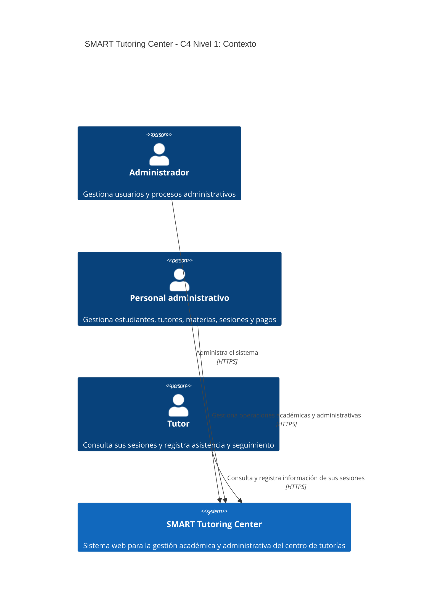
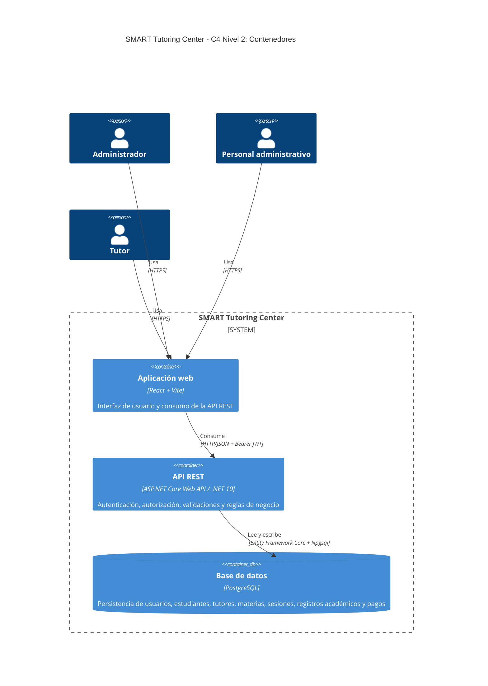
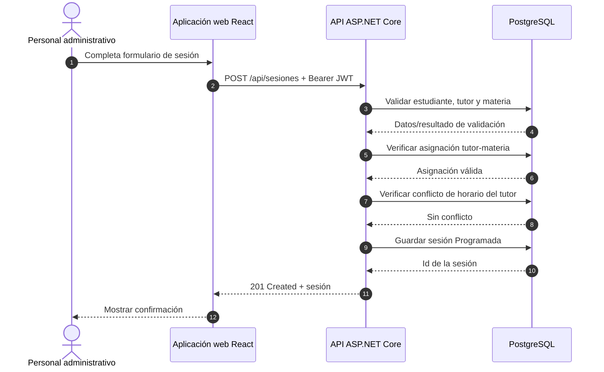
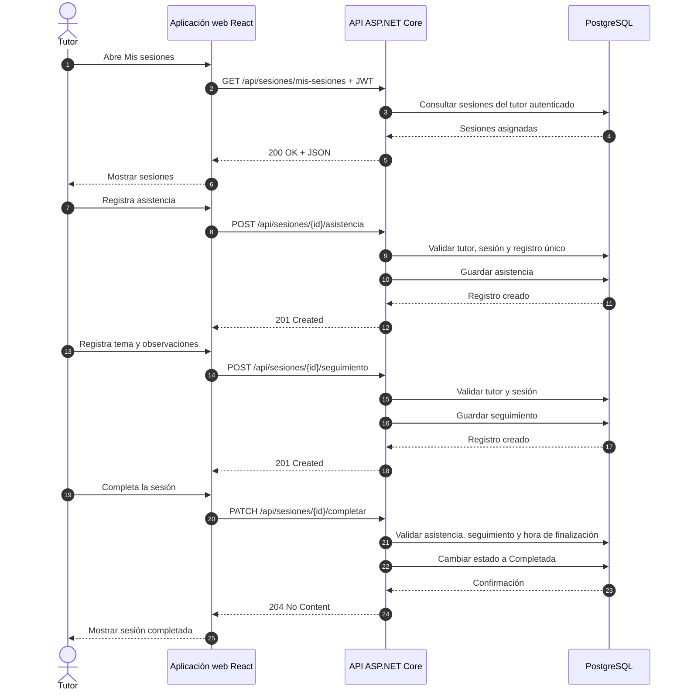

# SMART Tutoring Center

Sistema web de gestión académica y administrativa para **SMART Tutoring Center**. El proyecto centraliza los procesos principales del centro de tutorías: administración de usuarios, estudiantes, tutores, materias, sesiones, asistencia, seguimiento académico e historial de pagos.

El sistema se desarrolla como un piloto funcional para la asignatura **Diseño de Sistemas en Internet** de la Universidad Nacional de Ingeniería (UNI), utilizando una arquitectura web desacoplada y una API REST documentada.

## Objetivo

Centralizar la información académica y administrativa que actualmente se gestiona mediante registros manuales, reducir errores operativos y permitir que cada usuario acceda únicamente a las funciones correspondientes a su rol.

## Alcance funcional

El piloto contempla:

- Autenticación de usuarios.
- Autorización basada en roles.
- Gestión de usuarios administrativos.
- Gestión de estudiantes.
- Gestión de tutores.
- Gestión de materias.
- Asignación de materias a tutores.
- Programación, consulta, reprogramación y cancelación de sesiones.
- Validación de conflictos de horario del tutor.
- Registro de asistencia.
- Registro de seguimiento académico.
- Consulta de historial académico.
- Registro y consulta del historial básico de pagos.

## Roles

| Rol | Responsabilidades principales |
| --- | --- |
| Administrador | Gestiona usuarios y tiene acceso a los procesos administrativos del sistema. |
| PersonalAdministrativo | Gestiona estudiantes, tutores, materias, sesiones y pagos. |
| Tutor | Consulta sus sesiones y registra asistencia y seguimiento académico de las sesiones asignadas. |

## Stack tecnológico

| Componente | Tecnología |
| --- | --- |
| Frontend | React + Vite |
| Backend | ASP.NET Core Web API (.NET 10) |
| ORM | Entity Framework Core |
| Proveedor PostgreSQL | Npgsql |
| Base de datos | PostgreSQL |
| Autenticación | JWT Bearer |
| Documentación API | OpenAPI |
| Control de versiones | Git + GitHub |
| Formato de intercambio | JSON sobre HTTP/HTTPS |

## Arquitectura

La solución utiliza separación entre presentación, lógica de negocio/API y persistencia. El navegador nunca accede directamente a PostgreSQL; todas las operaciones se realizan a través de la API.

### C4 Nivel 1 — Contexto del sistema



### C4 Nivel 2 — Contenedores



## Diagramas de secuencia API-First

### Programar una sesión de tutoría



### Tutor registra asistencia y seguimiento



## API REST

La API sigue un enfoque basado en recursos y utiliza los verbos HTTP `GET`, `POST`, `PUT` y `PATCH`. Las rutas protegidas requieren un token JWT enviado como:

```http
Authorization: Bearer <token>
```

La documentación detallada de los endpoints se mantiene en [`docs/api.md`](docs/api.md).

En ambiente de desarrollo, OpenAPI está disponible en:

```text
http://localhost:5008/openapi/v1.json
```

## Seguridad

El backend implementa:

- Hash seguro de contraseñas mediante `PasswordHasher<TUser>` de ASP.NET Core.
- Tokens JWT con validación de emisor, audiencia, firma y expiración.
- Autorización basada en roles.
- Validaciones independientes de las restricciones del frontend.
- Restricción del tutor a sus propias sesiones y estudiantes vinculados.
- User Secrets para evitar publicar cadenas de conexión y claves JWT en GitHub.
- CORS restringido a los orígenes locales utilizados por el frontend durante el desarrollo.

## Estructura actual del repositorio

```text
smart-tutoring-web/
├── backend/
│   └── SmartTutoring.Api/
│       ├── Controllers/
│       ├── Data/
│       ├── Migrations/
│       ├── Models/
│       ├── Services/
│       └── Program.cs
├── docs/
├── SmartTutoring.sln
└── README.md
```

El frontend React se integrará en la carpeta `frontend/` durante el cierre de la Fase 2.

## Ejecución local del backend

### Requisitos

- .NET SDK 10.
- PostgreSQL.
- `dotnet-ef` compatible con EF Core 10.

### Configuración segura

Desde `backend/SmartTutoring.Api`, configurar los valores privados mediante User Secrets. No se deben guardar valores reales en el repositorio.

```powershell
dotnet user-secrets set "ConnectionStrings:DefaultConnection" "<CADENA_POSTGRESQL>"
dotnet user-secrets set "Jwt:Key" "<CLAVE_JWT_EN_BASE64>"
dotnet user-secrets set "Jwt:Issuer" "SmartTutoring.Api"
dotnet user-secrets set "Jwt:Audience" "SmartTutoring.Frontend"
dotnet user-secrets set "SeedAdmin:Email" "<CORREO_ADMIN>"
dotnet user-secrets set "SeedAdmin:Password" "<PASSWORD_ADMIN>"
```

Aplicar migraciones:

```powershell
dotnet ef database update
```

Ejecutar la API:

```powershell
dotnet run --launch-profile http
```

La API queda disponible en `http://localhost:5008`.

## Reglas de negocio relevantes

- Un tutor únicamente puede impartir una materia que tenga asignada.
- Un tutor no puede tener dos sesiones no canceladas que se superpongan en el mismo período.
- Solo una sesión programada puede registrar asistencia y seguimiento.
- Cada sesión admite un único registro de asistencia.
- Un tutor solo puede registrar información en sus propias sesiones.
- Una sesión con asistencia `Presente` requiere seguimiento académico antes de completarse.
- Una sesión no puede marcarse como completada antes de su hora de finalización.
- Los pagos deben estar asociados a un estudiante registrado y tener un monto mayor que cero.

## Documentación técnica

- [`docs/api.md`](docs/api.md): contrato REST y códigos HTTP principales.
- [`docs/arquitectura.md`](docs/arquitectura.md): decisiones de arquitectura y relación con C4/API-First.

## Equipo

- **Fátima Yamirel Herrera Lanzas** — backend, API, persistencia, seguridad e integración.
- **Álvaro Antonio Solano Parajón** — frontend e interfaz de usuario (responsabilidad inicial del equipo).

## Estado de la Fase 2

El backend se encuentra implementado y versionado en `main`. La etapa inmediata es completar la integración del frontend React, ejecutar las pruebas extremo a extremo y generar las evidencias finales de funcionamiento.
